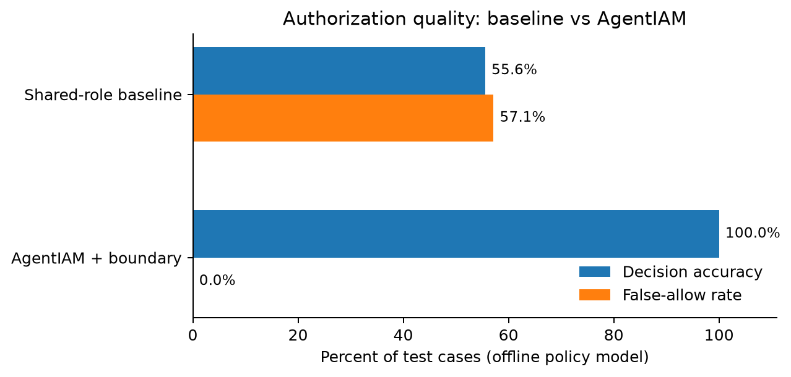
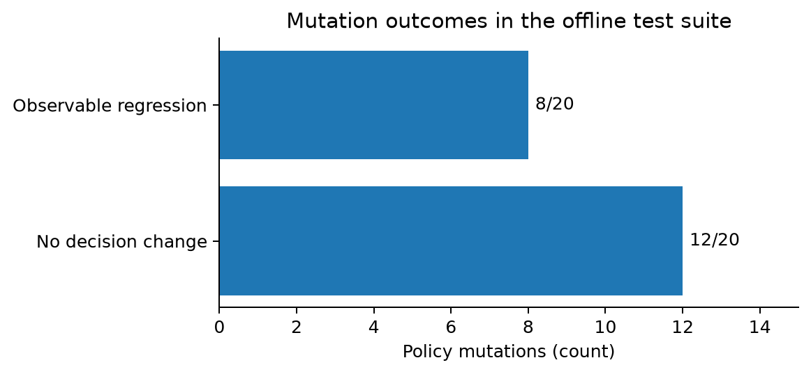

# AgentIAM-QV: Software Quality Verification for Task-Scoped AI-Agent Authorization

A reproducible **offline policy-model experiment** evaluating authorization correctness, regression testing, permission boundaries, and injected IAM-policy defects for four autonomous-agent workflows.

> **Evidence status (October 18, 2026):** The results below were produced by running a deterministic Python evaluator against researcher-authored **synthetic** test cases and policies. They are **not** outputs from the AWS IAM Policy Simulator, deployed AWS infrastructure, CloudTrail, or real production workloads. No AWS account is needed to reproduce them.

## Research question

Can independent expected-authorization specifications and mutation-based regression testing detect policy defects, while task-scoped permission boundaries prevent unintended access in a controlled AI-agent authorization model?

This is a software-quality evaluation of **functional correctness, regression behavior, and defect observability**, not a measurement of source-code complexity or live-cloud performance.

## Experiment design

1. **Independent oracle:** `data/requirements.json` defines allowed operations for provisioning, monitoring, remediation, and orchestration. `scripts/build.py` creates `data/oracle.csv` from those requirements, rather than inferring expected results from the policies being tested.
2. **Test cases:** Four workflows × nine candidate action/resource combinations = **36 cases** (8 expected allows and 28 expected denies).
3. **Configurations:** Compare an **intentionally overprivileged shared-role baseline** with the **task-scoped AgentIAM policy plus permission boundary**.
4. **Controlled mutations:** Generate five mutant types per workflow (pooled role, extra sensitive action, missing required action, explicit denial of a required action, and wildcard permissions), totaling **20 mutated policies**.
5. **Evaluation:** Run the local allow/deny evaluator across seven configurations for each of the 36 cases (**252 authorization decisions**). Compare each decision against the independent oracle and examine mutant outcomes.

All policy files and cases are research fixtures, not observational records from AWS.

## Reproduce the experiment locally

From the root of this repository, using Python 3.9 or later:

```bash
python3 scripts/build.py
python3 scripts/run.py --engine offline
python3 scripts/analyze_mutations.py
python3 -m pip install matplotlib
python3 scripts/make_figures.py
```

The commands rebuild the synthetic oracle and policy fixtures, execute local checks, analyze mutant behavior, and regenerate figures from CSV outputs. An AWS account or credentials are **not needed** for these steps.

## Input data and generated outputs

| Path | What it contains |
|---|---|
| [`data/requirements.json`](data/requirements.json) | Authored task-to-permission expectations |
| [`data/oracle.csv`](data/oracle.csv) | 36 independent expected allow/deny decisions |
| [`policies/`](policies/) | Baseline, task-scoped, boundary, and mutated JSON policies |
| [`results/offline_decisions.csv`](results/offline_decisions.csv) | All 252 case-level model decisions |
| [`results/offline_summary.csv`](results/offline_summary.csv) | Per-configuration true/false allow/deny counts and rates |
| [`results/offline_mutation_analysis.csv`](results/offline_mutation_analysis.csv) | Per-mutant observed decision/regression outcomes |
| [`figures/`](figures/) | Reproducible PNG, SVG, and PDF plots |

## Results of the executed offline experiment

| Configuration | Accuracy | Unauthorized requests incorrectly allowed |
|---|---:|---:|
| Overprivileged shared-role baseline | 55.56% | 16/28 (57.14%) |
| AgentIAM + permission boundary | 100% | 0/28 (0%) |

Each configuration uses the same **36 authored cases**. Both allowed all eight legitimate requests. The AgentIAM result applies **only to the tested fixtures**, and the baseline was deliberately configured to overgrant permissions; this is not a general comparison with real-world IAM deployments.

**Mutation outcomes:** **8/20** mutated policies produced observable authorization regressions (four missing-permission and four explicit-deny variants). **12/20** produced no changed decisions in the tested cases, because the permission boundary masked the introduced overpermissions. An unchanged decision is **not** proof that the underlying policy is defect-free, and 8/20 should **not** be presented as a generalized mutation score without adjudicating equivalent and masked mutants.

### Figure 1 — Authorization accuracy and false-allow rate



[View SVG](figures/offline_authorization_comparison.svg) · [View publication PDF](figures/offline_authorization_comparison.pdf)

### Figure 2 — Authorization policy mutation outcomes



[View SVG](figures/offline_mutation_outcomes.svg) · [View publication PDF](figures/offline_mutation_outcomes.pdf)

The two PNG images above are **embedded within this README**: GitHub displays them automatically using the files already in `figures/`. The graphics are generated from the offline CSV results rather than AWS responses.

## Evaluation metrics

For each independently expected authorization decision:

- **TP:** legitimate request allowed; **FN:** legitimate request denied.
- **FP:** unauthorized request allowed; **TN:** unauthorized request denied.
- **Accuracy** = (TP + TN) / (TP + TN + FP + FN).
- **False-allow rate** = FP / (FP + TN).
- **False-deny rate** = FN / (TP + FN).
- **Observed mutant regression:** a changed policy produces at least one decision that disagrees with the oracle. **Boundary containment** is reported separately; it may prevent an authorization error while still leaving an overpermissive underlying identity policy.

## Limitations and publication guidance

The local evaluator is a deliberately small allow/deny matcher and **does not implement the full AWS IAM engine**. These small, deterministic, researcher-selected policies and scenarios cannot establish external validity, production-grade security, real AWS evaluation outcomes, STS credential correctness, CloudTrail completeness, or performance. The weak baseline magnifies the contrast and must be disclosed. Independent review of the oracle, more realistic baseline policies, policy conditions and resource constraints, expanded mutations, and a separate authorization engine are recommended before stronger claims.

For a paper, call this a **preliminary offline policy-model software-quality evaluation**. Do not describe the results as AWS-measured, production-derived, or evidence of a broadly validated defect-detection rate.

## Optional future AWS evaluation (not yet executed)

If AWS access is later available and permitted, the runner supports the official AWS policy simulator:

```bash
python3 -m pip install boto3
aws sts get-caller-identity
python3 scripts/run.py --engine aws
```

The intended output files are `results/aws_decisions.csv` and `results/aws_summary.csv`. Review returned decisions, missing-context values, and action/resource compatibility before interpreting them. The AWS simulator does not execute underlying cloud operations or prove deployed security. See [AWS IAM SimulateCustomPolicy documentation](https://docs.aws.amazon.com/cli/latest/reference/iam/simulate-custom-policy.html).

## Reproducibility and use

The source, requirements, policies, decisions, analysis, and figures are provided to enable independent reproduction and extension. Reproducibility of these **offline model results** does not itself establish real-world impact or applicability to AWS production systems.
